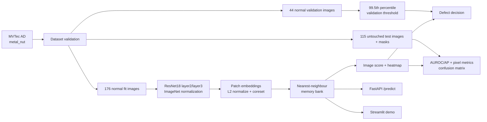
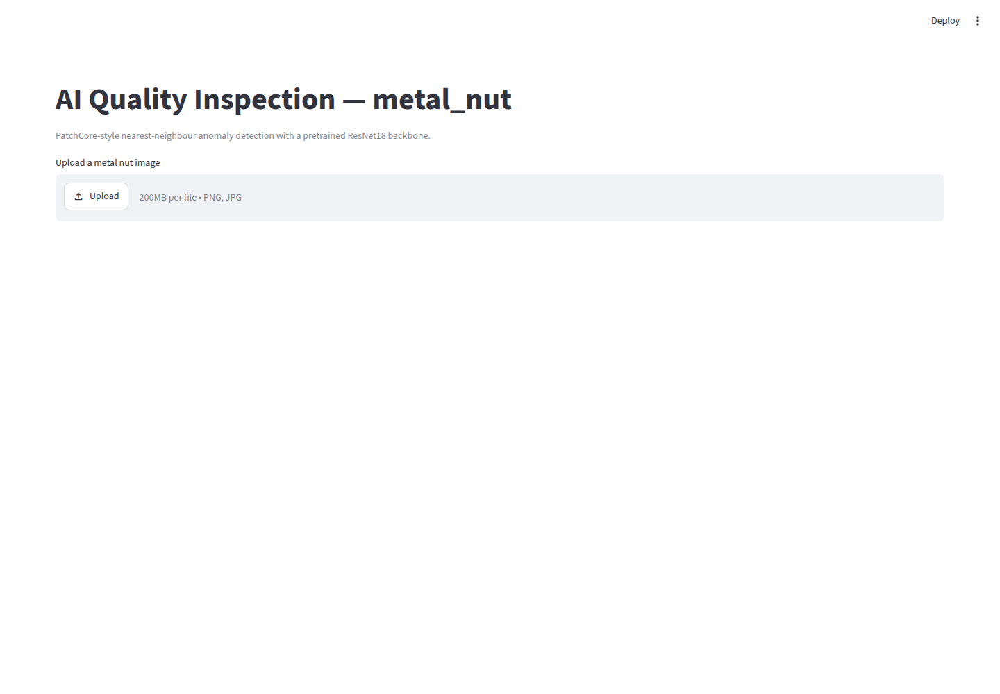
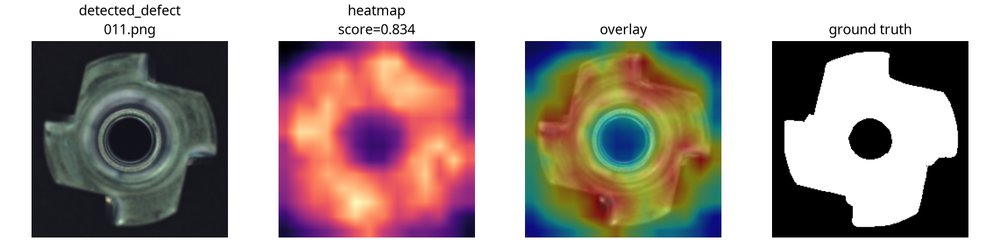

# AI Quality Inspection

CPU-compatible industrial anomaly detection for the MVTec AD `metal_nut` category using a frozen ImageNet ResNet18 PatchCore-style memory bank.

> A compact, reproducible baseline for visual quality inspection: learn normal appearance from defect-free parts, then localize unusual regions with nearest-neighbour patch distances.

## What is included

- Leakage-aware fit/validation/test workflow with validation-only threshold selection
- PatchCore-style ResNet18 layer2/layer3 patch memory bank and heatmaps
- Image-level and pixel-level evaluation against MVTec ground truth
- Streamlit inspection UI and FastAPI prediction endpoint
- Focused tests, reproducible example generation, and a CPU-loadable model artifact

## Architecture



## Technologies

Python · PyTorch · Torchvision · scikit-learn · Pillow · Matplotlib · FastAPI · Streamlit

## Audited evaluation

Dataset counts: **220 defect-free training images**, split deterministically into **176 fit** and **44 validation** images; **115 test images** (**22 normal, 93 anomalous**). Fit/validation overlap and train/test overlap were both zero. All 93 anomalous test images had a ground-truth mask.

The reported confusion matrix uses sklearn order `[[normal, anomaly], [normal, anomaly]]`:

```text
[[TN, FP],
 [FN, TP]] = [[21, 1],
              [24, 69]]
```

Treating `anomaly/defect` as the positive class:

- Precision: **0.9857142857** (`TP / (TP + FP)`)
- Recall / sensitivity: **0.7419354839** (`TP / (TP + FN)`)
- Specificity: **0.9545454545** (`TN / (TN + FP)`)
- F1: **0.8466257669**
- Image AUROC: **0.9496578690127078**
- Image average precision: **0.9881065982480634**
- Pixel AUROC: **0.9051387851743354**
- Pixel average precision: **0.5622084751751611**

The classification threshold is **0.6514729854464529**, selected as the 99.5th percentile of scores from the 44 defect-free validation images. It was not selected using test labels. Full machine-readable output is in [`artifacts/metal_nut/metrics.json`](artifacts/metal_nut/metrics.json).

### False-negative analysis

There were **24 false negatives out of 93 anomalous test images**. By defect type: `bent` 10/25, `color` 8/22, `scratch` 6/23, and `flip` 0/23. The current memory-bank detector is more sensitive to the flip defects in this split; subtle color, scratch, and bent defects often have scores below the threshold. This is descriptive of this run, not a claim of general performance.

A threshold estimated from only 44 normal images is statistically limited. At the 99.5th percentile, the empirical threshold is effectively governed by the largest few validation scores, so it has high sampling variability and does not guarantee a 0.5% production false-positive rate. The validation set contains no defects, so it cannot tune a precision/recall tradeoff for anomalies. A production deployment should collect a larger representative calibration set and define an operating point using its actual cost of false positives versus missed defects.

### Genuine visual examples

Each example contains the original image, PatchCore heatmap, heatmap overlay, and MVTec ground-truth mask:



The real Streamlit interface above was captured from the running app after the model artifact loaded. The evaluation examples below show actual inference outputs rather than design mockups.

- [Normal example](artifacts/metal_nut/examples/normal.png)
- [Detected defect example](artifacts/metal_nut/examples/detected_defect.png)
- [False-negative example](artifacts/metal_nut/examples/false_negative.png)
- [Example manifest](artifacts/metal_nut/examples/manifest.json)



The false-negative example is a real `color/004.png` test image with score `0.5760245919`, below the validation threshold. The detected example is a real `flip/011.png` image with score `0.8342230916`.

## Setup and execution

```bash
cd ai-quality-inspection
python3 -m venv .venv && source .venv/bin/activate
pip install -r requirements.txt
python scripts/download_mvtec.py --output data/mvtec_ad
PYTHONPATH=src python -m aqi.cli --data data/mvtec_ad --category metal_nut --output artifacts/metal_nut
PYTHONPATH=src pytest -q
```

The downloader defaults to the public `metal_nut` mirror at [Hugging Face](https://huggingface.co/datasets/MSherbinii/mvtec-ad-metal-nut), because the previously documented official archive URL returned HTTP 404 in this environment. The upstream dataset is [MVTec AD](https://www.mvtec.com/research-teaching/datasets/mvtec-ad); review its CC BY-NC-SA 4.0 terms before redistribution. An official archive can be supplied with `--source official --url <current-url>`.

Run the applications:

```bash
streamlit run src/aqi/streamlit_app.py
PYTHONPATH=src uvicorn aqi.api:app --reload
curl -F 'file=@path/to/image.png' http://127.0.0.1:8000/predict
```

Set `AQI_MEMORY_BANK` to use another saved memory bank. The checked-in project code expects the saved artifact at `artifacts/metal_nut/memory_bank.pt` by default.

### API reference

- `GET /health` returns service status and the configured memory-bank path.
- `POST /predict` accepts a multipart `file` containing a PNG or JPEG and returns `anomaly_score`, a 14×14 normalized `heatmap`, and the model name.

Scores are anomaly scores, not calibrated probabilities.

## Design and limitations

- Frozen ResNet18 layer2/layer3 ImageNet features are L2-normalized and compared against a deterministic coreset memory bank built only from fit images.
- Image scores are the mean of the top 10% patch distances. Pixel AUROC/AP use resized MVTec masks; normal images use all-zero masks.
- ImageNet normalization is applied after resizing to 224×224.
- The implementation is a compact PatchCore-style baseline, not a full production PatchCore reproduction. It does not include learned calibration, augmentation, multi-scale features, or a production monitoring layer.
- The model artifact is CPU-loadable and approximately 5.1 MB. The dataset is intentionally excluded from the project ZIP.

## Verified test results

The current test suite result is:

```text
4 passed
```

FastAPI smoke tests returned HTTP 200 for one normal and one anomalous test image. Streamlit started successfully and served HTTP 200. The audited source commit is `6f4d2fd` (`Use validation-only anomaly threshold`).

## Structure

```text
src/aqi/       dataset validation, model, evaluation, API, Streamlit
scripts/       dataset download and example generation helpers
tests/         focused unit and regression tests
artifacts/     corrected metrics, memory bank, and visual examples
data/          local dataset only; excluded from ZIP and Git
```

## Contributing

Small, focused pull requests are welcome. Keep dataset files, model caches, credentials, virtual environments, and temporary generated files out of Git. Run `PYTHONPATH=src pytest -q` before submitting changes and tie evaluation claims to reproducible artifacts.

## License

Project code is released under the MIT License in [`LICENSE`](LICENSE). The MVTec AD dataset is separate and remains subject to its upstream CC BY-NC-SA 4.0 terms.
